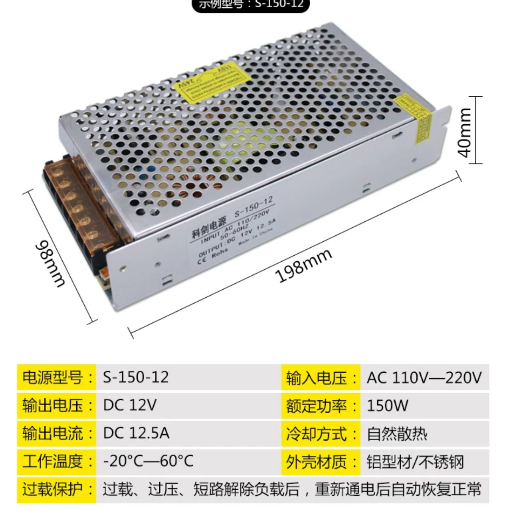
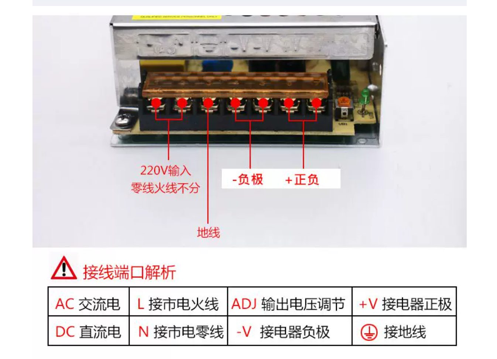
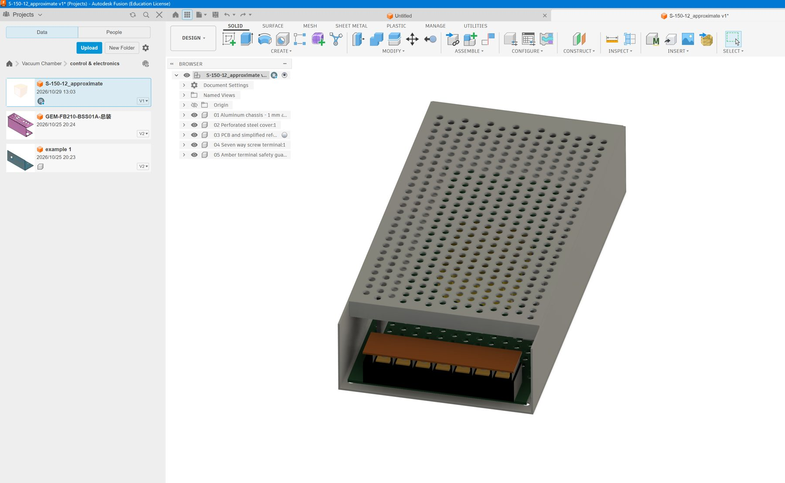

# Example prompt: S-150-12 power supply in Fusion 360

This example records the user's original request, the information provided in the two reference images, and a screenshot of the resulting approximate Fusion model.

## Original user prompt

> model this in fusion 360. give me a f3d file. dimention don't need to be exact if there is no t enough information

## User-provided reference information

The first image identifies the product as an **S-150-12** power supply and gives approximate overall dimensions of **198 × 98 × 40 mm**. The image labels its output as **12 V DC**, **12.5 A**, rated power **150 W**, and input as **110–220 V AC**. It shows a perforated metal cover, rectangular housing, and a terminal block with a protective cover.

The second image shows the terminal end with seven terminals and a protective cover. Its annotations group the terminals as AC input, earth, negative output and positive output, and mention an output-voltage adjustment. These are image annotations, not independently verified product specifications or wiring instructions.

## Reusable English prompt

> Create an approximate Fusion 360 model of the S-150-12 switching power supply shown in the two reference images. Export a native F3D file. Use the illustrated 198 × 98 × 40 mm overall dimensions as a starting point. Model the metal enclosure, perforated cover, internal board and simplified components, seven-position screw terminal block, and protective terminal cover. Apply recognizable materials and colors. If a dimension or internal detail is not provided, estimate it and clearly identify the assumption rather than presenting it as measured.

## Result screenshot

The user provided this screenshot of the approximate Fusion model. The screenshot documents the visual result; it does not establish dimensional accuracy, electrical compatibility, or the current status of the native F3D file.

