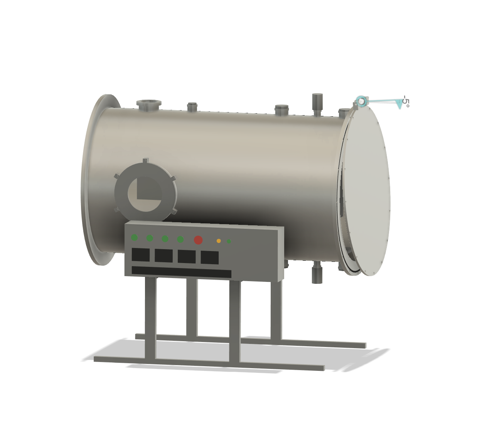

# Example prompt: Electric-propulsion vacuum chamber in Fusion

This example consolidates a design conversation into a reusable prompt. The picture below is the user-provided screenshot of the resulting **concept**, not a verified fabrication design.

## Prompt

> Act as a vacuum-system and electric-propulsion design engineer. Research the relevant papers and manufacturer documentation, review the project equipment spreadsheet where accessible, and create a Fusion 360 concept for a shared test facility for an ion thruster, a Hall thruster, and an applied-field MPD thruster. Mark missing information and distinguish confirmed equipment, proposed dimensions, and unverified assumptions. Ask the essential questions together and explain any conflicts.
>
> Start with a horizontal cylindrical 304 stainless-steel chamber, approximately 550 mm outside diameter and 1,000 mm cylindrical length. Place the chamber on a stand or table with its long axis parallel to the XY plane. The non-removable structure must fit within 750 mm transport width; detachable items such as the turbo pump and control box are excluded from that transport limit. Aim for a closed assembly length under 1,200 mm and allow additional space for the open door. The final installation height and table capacity remain to be established.
>
> First compare alternative layouts for the end door, viewport, pump port, and diagnostics; then develop the selected concept. Put a large DN200 side viewport where it can observe the thruster and plume. Model the glass transparently and use an actual manufacturer's dimensions for the flange and clear viewing area; DN200 is a nominal connection size, not necessarily the optical aperture. Include an appropriate seal and realistic mounting hardware. Show a horizontal side-mounted Edwards EXT255H-type turbomolecular pump using verified manufacturer's geometry where available, and provide space for its backing connection, cooling, cables, and service access. The exact pump version and accessories must be verified.
>
> Provide an end access door with a gasket and groove, bolt holes and a hinged connection that can be opened in the assembly. Include a removable, adjustable internal mounting arrangement for interchangeable thrusters and a common thrust-stand concept; actual thruster dimensions and the stand's measurement performance are unknown. Reserve accessible, correctly identified interfaces for vacuum gauges, gas supply, high-voltage and high-current feedthroughs, optical diagnostics, and interchangeable Langmuir, Faraday, and retarding-potential probes. Check port placement, line of sight, internal clearance, and component interference. Use standard commercially available interfaces only when their complete mating details have been verified; label custom or indicative features clearly.
>
> Place a convenient operator panel on the stand with physical start/stop controls, status indicators, pressure and temperature readouts, electrical measurements, data logging, and provisions for independently reviewed interlocks. Argon is the initial propellant; leave a path for xenon or krypton later. The reported flow controller range is 0–50 sccm, but the needed operating flow, chamber pressure, electrical ratings, run duration, and many diagnostics are still unknown. Estimate candidate values from cited research and pump capability, and label them as estimates rather than requirements or measured results.
>
> Assign appropriate materials and appearances, including clear glass. Show meaningful components and make the door motion operable in the assembly. Check geometry and selected door positions for interference, explain any remaining collisions or unmodeled motion, and provide a native F3D file. If asked to modify an existing open model, inspect the live document first and preserve existing work. Provide a full-system concept and a phased plan for the requested USD 1,300 and USD 2,000 scenarios, excluding pumps as specified; distinguish actual quotes from assumptions and include shipping when available.
>
> Assess the proposed 5 mm chamber wall and the large viewport opening using an appropriate external-pressure structural assessment, including local opening effects and buckling where applicable. If Fusion Simulation or a required solver is unavailable, report exactly what was and was not run. Never infer that a design is safe from a CAD rendering, an interference check, or an incomplete analysis. Identify unresolved pressure, support, material, weld, door, viewport, and thermal requirements before manufacturing or vacuum operation.

## Result and limitations

The screenshot shows a horizontal chamber concept with a side viewport, operator panel, support frame, and an end door shown partly open. Some components and interfaces are illustrative. The conversation produced Fusion concept models and sampled door/interference checks; it did **not** establish a completed Fusion Simulation result or demonstrate that the 5 mm wall and large opening are structurally adequate. The actual window assembly, hinge, fasteners, pump model, pressure rating, and operating conditions require independent verification.

The screenshot is a visual record of a design iteration. It is not evidence that the latest live Fusion document was saved or that its complete assembly and analysis were qualified.

