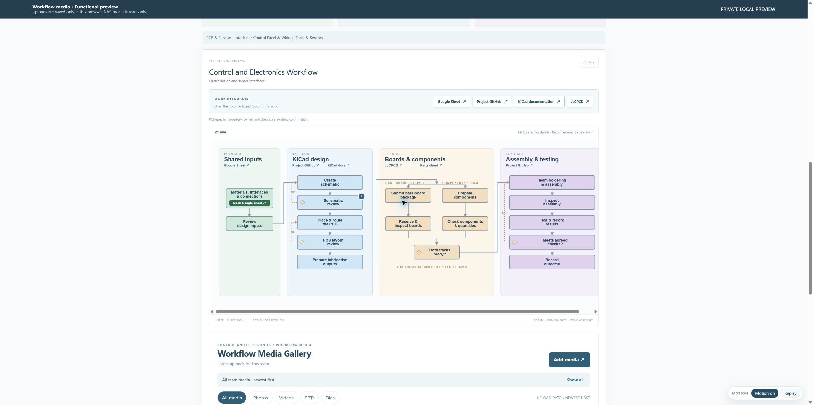
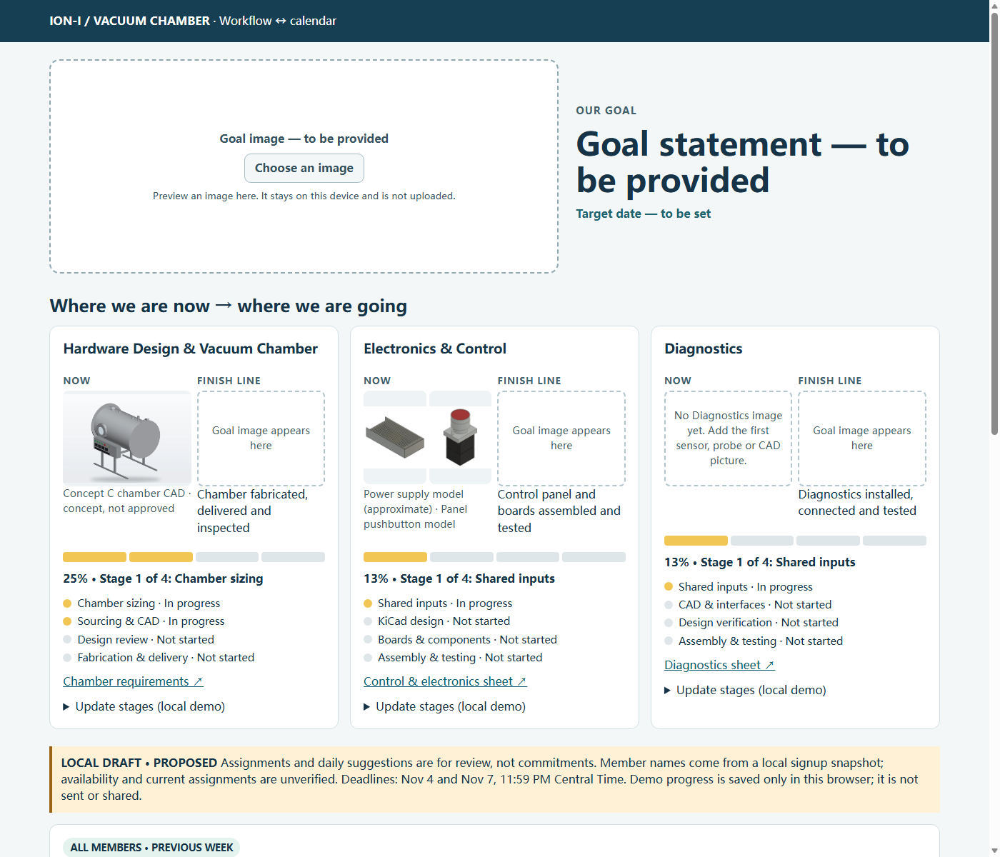
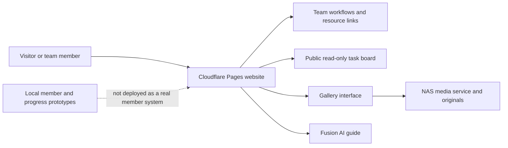

# Building the Ion-i Vacuum Chamber Team Website

**A case study of iterative, prompt-led design · October 26–November 1, 2026**

The Ion-i team needed a place where a new member could understand the project, find their team's workflow and resources, and see the photos and videos that document the work. The site grew through a cycle of requests, multiple visual prototypes, hands-on feedback, implementation, and tests on the deployed system.

This is a reconstructed account, not a complete transcript. Prompt excerpts below are English translations or condensed paraphrases of the original Chinese requests. Screenshots are explicitly identified as previews. Feature status describes the evidence available through November 1, not a promise of present availability.

**Website:** [Ion-i Vacuum Chamber](https://ion-i-vacuum-chamber.pages.dev/) · **Project repository:** [ioni-vacuum-chamber](https://github.com/ryanzhao/ioni-vacuum-chamber)

## The starting idea

The initial October 26 request was to use Sites to plan a simple, editable, responsive team website. It should show what each subteam was doing, connect diagrams to resources such as spreadsheets, and provide a photo gallery. The original idea also included member information; the public project record avoids publishing names and contact details.

The core design problem was how to show the *whole project* without overwhelming a member looking for the *next action*. Rather than produce one final design immediately, the process used side-by-side versions, selected pieces of preferred versions, and refined them against real team workflows.

## How the site developed

| When (US Central) | Step and design decision | Evidence and boundary |
| --- | --- | --- |
| October 26 | Defined a minimal, English-language, phone/tablet/desktop site; compared alternatives and combined elements from multiple concepts. Linked workflow stages to the resources needed to do the work. | Initial planning and local prototypes; an idea in a prototype is not necessarily a released feature. |
| October 26–27 | Expanded the three team areas into color-grouped workflow diagrams. The PCB example connected shared inputs, KiCad work, board fabrication, team assembly and testing. Requirements evolved from separate work diagrams to a more complete team-level view. | Diagram content is a planning aid, not an accepted engineering result or personal assignment. |
| October 26–28 | Connected a NAS-backed photo/video gallery and developed upload flow, metadata, and workflow links. Tested a real batch of two images and a short video through one final confirmation. | This test established the sampled batch flow, not a comprehensive large-file or all-browser guarantee. |
| October 28–30 | Iterated on workflow-linked media, highlighted uploader selection and upload celebration, added Meeting as a category, and introduced original-quality viewing and password-authorized download. | The gallery and NAS components were released in stages. The original-video playback and actual browser download were not separately verified in the recorded release checks. |
| October 30–31 | Explored several member-task layouts, a split view, and workflow highlighting. Released a public, initially collapsed, read-only three-week task board on October 31. | Deployment `36148216` was checked against live assets. The 21 example plan cards were unassigned; the existing five-week project roadmap was not replaced. |
| November 1 | Explored visual progress, project-to-team-to-person navigation and three login presentations. | Local prototypes only. Their sample progress, names, login states and dates are not verified live project data. |

## Prompts that shaped the result

These examples preserve the intent of representative requests. They are translated and shortened for readability; they are not a verbatim or exhaustive prompt archive.

1. **Start with a plan.** “Create a minimal team site where members can see what they need to do, follow diagrams to shared resources, view project results and photos, and use it on a phone, tablet or computer.”
2. **Show hierarchy without a wall of text.** “Group the major phases with colored backgrounds, then show the smaller steps inside each phase; do not put everything in one long chain.”
3. **Make the diagrams useful.** “Connect the workflow boxes to the relevant spreadsheets and tools, and let the media below correspond to the selected work.”
4. **Keep uploads simple and accurate.** “Use capture time from the file or filename when available, allow the uploader to correct it, and require only one final Confirm upload action.”
5. **Make feedback visible.** “Highlight the uploader field, hide AI analysis from the upload interface, and show an obvious celebration even when the user is elsewhere on the page. Give me three versions.”
6. **Connect media to progress.** “Keep the workflow visible and highlight the relevant stage when viewing a category of material.”
7. **Help members focus.** “Make the daily to-do list immediately understandable, with enough information to act but without an overwhelming block of text. Show alternatives first.”
8. **Keep public access simple.** Visitors should be able to browse without logging in; personal planning and member actions need an appropriate member experience. The public task-board release and the later login prototypes have different implementation status.

The request that changed the most was the relationship between overview and detail. Early exploration asked for a separate diagram per work item; subsequent feedback asked for a complete team diagram with color-grouped stages and navigable details. The structure was refined through use rather than assumed to be settled on day one.

## Design in pictures

*Local functional preview: the Electronics & Control workflow groups shared inputs, design, boards/components and assembly/testing. The image is an example of the visual approach, not proof that every preview feature was released.*

*Local November 1 concept: a project goal and three team progress cards. The percentages, dates and stage labels shown are demonstration data, not verified team progress. Goal images and text were still placeholders.*

## Architecture and achieved features

The verified historical releases included a team-oriented homepage and workflow navigation; a NAS-backed gallery for photos and videos; upload and metadata flows; a Meeting category; workflow-linked media browsing; original-quality image viewing and password-authorized original downloads; a Fusion AI guide entry; and the unassigned public task board. The gallery's protected removal flow was designed to hide items while preserving NAS originals and user annotations; the recorded test rejected an incorrect password without deleting real user media.

Availability of a button or endpoint does not by itself verify every device, file size, media type, access policy or current service. The webpage and NAS are separate deployment components; local copies are not necessarily the production source of truth.

### Still prototypes or unresolved

- Real member authentication, personal weekly plans, shared assignment and handoff workflows, identity reuse, and automatic Notion synchronization were not part of the October 31 public-board release.
- The November 1 goal/progress and login alternatives used demonstration data and local interaction; selecting a name in a prototype is not proof of secure authentication.
- The three-week task-board view and the existing five-week roadmap need reconciliation before either is treated as the definitive schedule.
- NAS gallery filter changes and the corresponding Pages candidate did not all share the same release status. A Pages candidate remained pending preview approval in the recorded October 31 work.
- Project images and conceptual CAD are illustrations; they do not establish manufacturing readiness, testing, or engineering approval.

## Problems, decisions and checks

| Problem | Response | What was actually checked |
| --- | --- | --- |
| Team work was difficult to follow across documents. | Used colored stages, individual workflow steps and direct resource links; iterated through alternate layouts. | Local visual previews and selected interaction tests; workflow text remains subject to project review. |
| Uploading several media items felt repetitive. | Removed per-file confirmation and kept one final confirmation after metadata entry. | A real test uploaded two photos and one short video, then showed the three items in the gallery. |
| Media lost the context of the work it documented. | Associated materials with team/workflow stages and added visual highlighting while browsing. | Staged and released gallery interactions were checked, though individual content classifications still need human review. |
| A narrow task panel did not visibly highlight the workflow. | Embedded a scrollable diagram, dispatched highlights immediately and adjusted restore timing. | Browser checks covered Hardware, Electronics/PCB and Diagnostics flows during the task-board work. |
| A production release risked overwriting parallel changes. | Rebuilt from a checked production baseline and compared release assets before publishing. | Eleven live assets matched the task-board release; the assignment endpoint and Fusion guide responded. |
| Continuous AI polling could keep the NAS active. | Changed the gallery AI schedule to a once-daily batch after the owner enabled the timer. | Timer and service state were checked; disk sleep itself was not established by the short observation. |
| Guest access and real member workflows had different needs. | Shipped the unassigned public board first and kept member login, handoff and progress ideas in local previews. | The released board and local prototypes were separately tested; real authentication and synchronization remain unverified. |

## Time and token estimate

**Calendar span:** the first identified website request was October 26, 2026, and the latest local concept covered here was November 1: roughly **six calendar days**. This includes pauses, parallel work and local drafts; it is not six days of continuous labor.

The following is a reproducible **sample of five related Codex chats**, not a complete project bill. For each chat, the table uses the last `total_token_usage` snapshot found across its continuation files, so earlier cumulative snapshots of the same chat are not added again. “Active turn time” is the sum of recorded start-to-complete/abort intervals, including tool waits. Parallel chats may overlap, and chats can include unrelated work. Records lacking matching events and work outside these chats are excluded.

| Related chat | Recorded active turn time | Last cumulative total tokens | Included cached input tokens |
| --- | ---: | ---: | ---: |
| Initial site and NAS | ~14.40 h | 431.28 million | 422.08 million |
| Team website design | ~2.65 h | 330.05 million | 321.20 million |
| Team website design, continued | ~1.76 h | 395.88 million | 385.84 million |
| Photo library | ~8.31 h | 788.14 million | 776.60 million |
| Daily task-board design | ~1.40 h | 88.49 million | 85.10 million |

The arithmetic sum is **~28.5 recorded turn-hours** and **~2.03 billion cumulative tokens**, of which **~1.99 billion were reported as cached input**. This is only a rough scale indicator for these selected chats: it may include shared/inherited context, repeated context reads, overlapping time, and unrelated work; it excludes other relevant chats. It is **not** unique text, wall-clock hours worked by the user, an exact website-only count, an invoice, or a dollar-cost estimate. Cached and uncached tokens can have different accounting, and no pricing or billing records were used.

## Evidence and limitations

The account draws on the original local Codex session messages and token-count events, selected deployment and test notes, the public repository, and the existing local screenshots shown above. It intentionally omits credentials, personal contact details, raw conversation history and live media originals. Prompts were translated or condensed, and local screenshot captions distinguish prototypes from releases. The website could not be independently reopened by the web reader while this document was prepared, so live availability is not asserted beyond the dated release checks.
